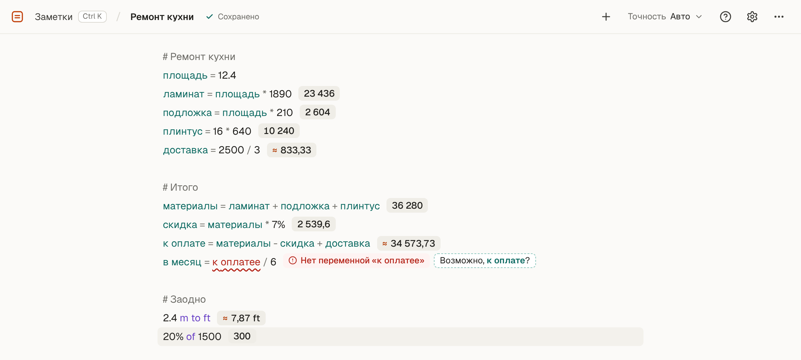
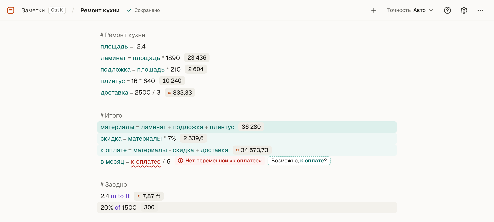
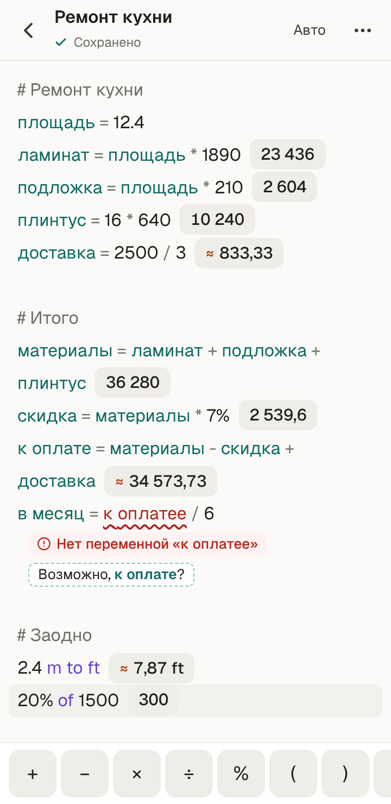

<p align="center">
  
</p>

<h1 align="center">calqnotes</h1>

<p align="center">
  Заметки, которые умеют считать. Пишите расчёт строкой — результат появится рядом.
  <br>
  <a href="https://redfur.github.io/calqnotes/"><b>Открыть приложение →</b></a>
</p>

<picture>
  <source media="(prefers-color-scheme: dark)" srcset="docs/images/screenshot-dark.png">
  
</picture>

## Зачем это

Смета ремонта, бюджет поездки, зарплата после налогов, рецепт на шесть порций — такие расчёты неудобно делать в калькуляторе: числа теряются, а через неделю уже не вспомнить, откуда что взялось. В таблице — слишком много возни.

calqnotes — что-то среднее: обычный текст, где каждая строка сразу считается. Числам можно давать имена, менять их и смотреть, как пересчитывается всё остальное. Заметки сохраняются сами.

## Что умеет

```
# Ремонт кухни
площадь = 12.4
ламинат = площадь * 1890            23 436
доставка = 2500 / 3                 ≈ 833,33
итого = ламинат + доставка          ≈ 24 269,33

1250 * 12 - 15%                     12 750
20% of 500                          100
2 inch to cm                        5,08 cm
sqrt(144)                           12
```

- **Переменные** — `площадь = 12.4`, в том числе из нескольких слов: `на руки = зарплата - налог`. Наведите на имя — подсветятся строки, где оно используется.
- **Проценты как в калькуляторе** — `1250 - 15%`, `20% of 500`.
- **Единицы измерения** — `2 inch to cm`, `5 km / 25 min to km/h`, `72 kg to lb`.
- **Функции** — `sqrt`, `round`, `min`, `max`, `sum`, `sin` и другие. `last` — результат строки выше.
- **Аккуратные числа** — `1 234 567,89` вместо `1234567.891`, `≈` у округлённых, точное значение — при наведении. Точность можно задать для всех заметок или для одной.
- **Копирование в один клик** — нажмите на результат.
- **Понятные ошибки** — «Нет переменной «к оплатее»» и кнопка «Возможно, к оплате?», которая исправит опечатку.
- **Комментарии** — всё после `#` просто текст.
- **Поиск по заметкам** — по названию и по тексту, Ctrl K.
- **Светлая и тёмная тема**, шпаргалка по синтаксису внутри приложения.
- **Русский и английский интерфейс** — язык выбирается по браузеру и меняется в настройках.
- **Работает без интернета и ставится как приложение** — на телефон или компьютер, из Chrome, Edge или Safari (iPhone: «Поделиться» → «На экран „Домой“»).

<table>
  <tr>
    <td width="68%"></td>
    <td></td>
  </tr>
  <tr>
    <td>Наведите на переменную — видно, от чего она зависит и что от неё зависит</td>
    <td>На телефоне — строка символов над клавиатурой</td>
  </tr>
</table>

## Горячие клавиши

| Клавиши | Что делают |
|---------|------------|
| <kbd>Ctrl</kbd> <kbd>K</kbd> | Найти или открыть заметку |
| <kbd>Ctrl</kbd> <kbd>S</kbd> | Сохранить сейчас |
| <kbd>F2</kbd> | Переименовать заметку |
| <kbd>Ctrl</kbd> <kbd>D</kbd> | Дублировать строку |
| <kbd>Ctrl</kbd> <kbd>/</kbd> | Сделать строку комментарием |
| <kbd>Tab</kbd> | Принять подсказку |

На macOS вместо <kbd>Ctrl</kbd> — <kbd>⌘</kbd>.

## Где хранятся заметки

Только в вашем браузере (IndexedDB). Аккаунта нет, на сервер ничего не отправляется, а после первого открытия приложение работает и без интернета. Поэтому заметки привязаны к браузеру и устройству: если очистить данные сайта, они пропадут. Экспорт в файл скоро появится.

## Разработка

React 19, TypeScript, Vite, Tailwind CSS 4 и shadcn/ui, CodeMirror 6, math.js, Zustand.

```bash
npm install
npm run dev      # локальный сервер
npm test         # тесты движка и форматирования (Vitest)
npm run check    # линтер и форматирование (Biome)
npm run build    # сборка в dist/ (вместе с service worker)
npx vite preview # проверить сборку: офлайн и установка работают только в ней
```

- [spec/](./spec/) — спецификация: что есть в системе и как должно работать.
- [docs/coding-standards.md](./docs/coding-standards.md) — правила кода и структура Feature-Sliced Design.
- [spec/roadmap.md](./spec/roadmap.md) — что планируется дальше.

Каждый push в `main` публикуется на GitHub Pages.

## Docker и релизы

Отдельный workflow [container.yml](.github/workflows/container.yml) по push тега `vX.Y.Z` проверяет версию, запускает `npm run check`, `npm test` и сборку, затем публикует Linux/amd64-образы:

```text
ghcr.io/redfur/calqnotes:vX.Y.Z
ghcr.io/redfur/calqnotes:latest
```

Перед релизом обновите версию в `package.json` и `package-lock.json` командой `npm version X.Y.Z --no-git-tag-version`, закоммитьте изменения, создайте тег `vX.Y.Z` на этом коммите и отправьте коммит и тег в GitHub. Контейнер собирается из исходников тега; версия тега должна совпадать с `package.json`. Через Actions → Publish container to GHCR → Run workflow можно повторить публикацию существующего тега. Тег должен содержать Dockerfile и конфигурацию nginx.

Публикация использует встроенный `GITHUB_TOKEN` с `packages: write`, отдельный секрет не нужен. После первой публикации проверьте видимость пакета в GHCR: для скачивания без авторизации сделайте пакет public; для private-пакета на сервере нужен `docker login ghcr.io` с доступом на чтение. `latest` обозначает последнюю успешную публикацию, в том числе ручную пересборку старой версии.

### Запуск на сервере

Скопируйте [compose.yaml](compose.yaml) на сервер и создайте рядом `.env` с уже опубликованной версией:

```ini
CALQNOTES_VERSION=v1.0.0
CALQNOTES_PORT=8081
```

```bash
docker compose pull calqnotes
docker compose up -d --wait
```

Для обновления или отката измените версию в `.env` и повторите эти команды. Без `CALQNOTES_VERSION` Compose остановится. Публикация образа сама по себе не обновляет работающие контейнеры.

Приложение слушает `127.0.0.1:8081`; внешний nginx или другой reverse proxy должен направлять на этот адрес запросы вашего домена и обеспечивать HTTPS для PWA. Порт можно изменить через `CALQNOTES_PORT`. Node и исходники на сервере не нужны. Том с данными тоже не требуется: заметки хранятся в браузере. При смене домена прежние заметки автоматически не переносятся; экспорта в приложении пока нет.

### Локальная проверка

```bash
docker build --build-arg GITHUB_SHA="$(git rev-parse HEAD)" -t calqnotes:local .
docker run --rm -p 127.0.0.1:8081:80 calqnotes:local
```

Откройте `http://localhost:8081`. Сборка внутри образа использует базу `/`, независимо от пути GitHub Pages. В nginx настроены кеширование PWA и healthcheck. Аргумент `GITHUB_SHA` сохраняет ссылку на коммит в разделе «О приложении», поскольку `.git` исключён из Docker-контекста.

## Спасибо

Идея — из [Calque](https://github.com/grimalschi/calque), calqnotes — его современная переработка.

## Лицензия

[MIT](./LICENSE)
